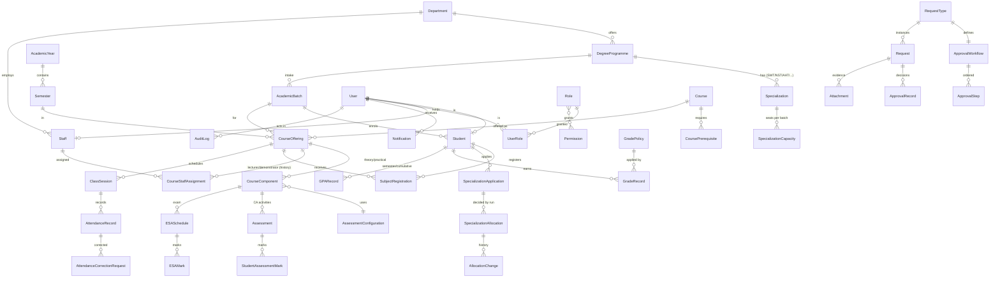
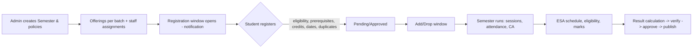
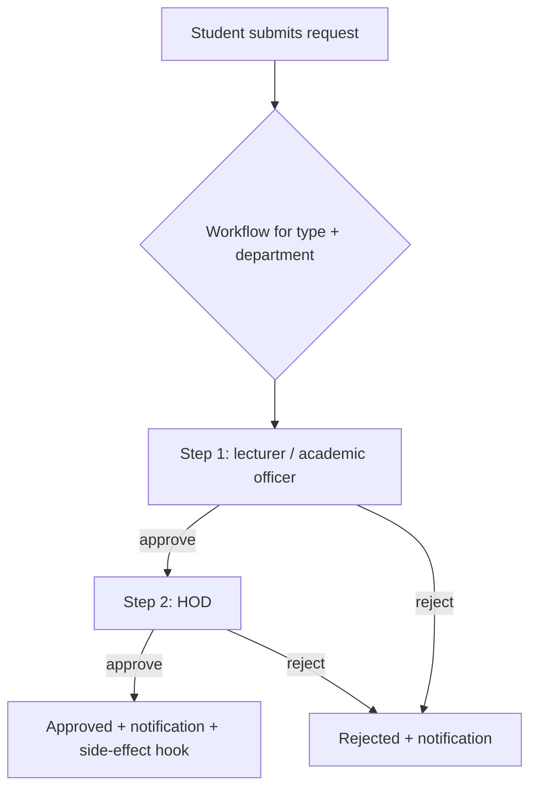
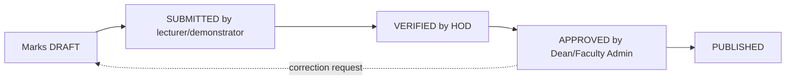

# SEUConnect Backend – Analysis, Architecture and Implementation Plan

Scope: backend only (APIs, data model, business rules). Source of truth for academic rules is the Faculty
Handbook; **the handbook file was not available to the author**, only the requirement specification that quotes
it. Every rule that depends on the handbook is listed in section 11 and is implemented as configurable policy,
never as a hard-coded value.

---

## 1. Existing repository and backend analysis

| Area | Finding |
|---|---|
| Stack | Node 24, **Express 5**, **Mongoose 9**, **MongoDB** (now MongoDB Atlas, replica set → transactions available), JWT (`jsonwebtoken`), scrypt password hashing. CommonJS. |
| Layout | `Backend/{config,controllers,controller,models,routes,router,middleware,store,utils,workflows}`; two historic naming styles (`controller/` + `router/` is the student module). |
| Existing APIs | `/api/auth`, `/api/processes` (five examination-form workflows from the approved PDF), `/api/notifications`, `/api/stats`, `/api/academic-calendar`, `/api/student` (legacy, embedded-document student record). |
| Existing models | `User` (single `role` string), `ProcessRequest` (+ embedded stages/audit), `Notification`, `Setting`, `AcademicEvent`, `Student` (large denormalised document: profile, attendance, results, GPA embedded). |
| Auth | Bearer JWT, role checks via `authorize(...roles)`. No refresh/expiry strategy, no rate limiting, no password policy. |
| Gaps vs. specification | No Department/Degree/Specialization/Batch/Year/Semester entities (department is a free string); no RBAC data model (roles are an enum); no course / offering / registration / attendance / assessment / ESA / grade / GPA modules; no allocation engine; no generic request engine; no immutable audit log; no request validation library; no migrations; hard-coded batch student counts in `statsController`; the only automated test is `test_workflows.js`. |
| Reusable | JWT + password utilities, `store` hybrid pattern (kept for the examination workflows), notification model, the examination-form engine (approved PDF – **kept as-is**), Student collection name. |
| Defects found | Student `Student` model duplicates attendance/results inside one document (cannot be queried by course or audited); `academicCalendarController` falls back to in-memory data silently; stats use constants. |

**Decision – keep the stack.** The specification asks for a "normalised relational database", but the project is
MongoDB on Atlas with working code. A document database does not prevent normalised design: every aggregate has
its own collection, references are `ObjectId`s, uniqueness is enforced with **unique compound indexes**, and
multi-document invariants use **MongoDB transactions** (Atlas replica set). Replacing the database would discard
working code and the Atlas investment without a technical need.

**Documented exception to "no duplicate workflow systems".** The five examination-form workflows (ECA, ESA,
Examination Form, Subject Medical, Examination Medical) are defined by the approved PDF with special steps
(department lists, two SAR outputs). They stay in the *Examination Workflow* module. The new generic
configurable *Request* engine (section 13 of the spec) serves every other request type and can host the others
later.

---

## 2. Recommended architecture

Modular monolith, strictly layered. Existing endpoints stay under `/api/*`; everything new is under
`/api/v1/*` so the running frontend never breaks.

```
Backend/
  core/                       shared infrastructure (no business rules)
    http.js        ApiError hierarchy, asyncHandler, response helpers, centralized error middleware
    validate.js    zod-based request validation middleware
    pagination.js  page / limit / sort / filter parsing and paginated queries
    transaction.js withTransaction(): session + retry on transient errors
    rbac.js        permission catalog, role catalog, effective-permission resolver, requirePermission()
    audit.js       append-only audit writer
    policy.js      typed reader for AcademicPolicy / SystemSetting
    notify.js      notification service with pluggable delivery providers (in-app now, e-mail later)
    logger.js      levelled JSON logger
    upload.js      secure document storage (multer, allow-list, random names, authenticated download)
    scope.js       data-scope guards (own / assigned / department / faculty)
  modules/<module>/           one folder per bounded context, auto-registered under /api/v1/<module>
    model.js  service.js  controller.js  routes.js  validation.js  (+ tests)
  migrations/                 ordered, idempotent migration files + runner (tracked in `migrations` collection)
  scripts/                    backup / export, seed, migrate
  tests/                      unit (pure engines), integration (API + DB), permission, concurrency
```

Rules: **controllers** parse/validate and call services; **services** hold all business logic and transactions;
**models** hold schema + constraints only; pure calculation engines (`allocationEngine`, `resultEngine`,
`attendanceMath`) have no DB access so they are unit-testable.

Cross-cutting: centralized error handler → `{ success:false, error:{ code, message, details } }`; success →
`{ success:true, data, meta }`; Helmet headers, `express-rate-limit` (strict on login), request ids, structured
logs, environment-based config (`.env`, `.env.example`), no secret in git.

---

## 3. Entity relationship diagram



---

## 4. Collection and relationship plan

`ObjectId` references, `timestamps: true` everywhere, soft status instead of deletion for academic records.
**U** = unique index, **I** = index.

**Organisation** – `Department {code U, name, headStaff?, status}` · `DegreeProgramme {code U, name, department,
durationYears=4, semestersPerYear=2, specializationStartsAt{year:3,semester:1}, status}` · `Specialization
{programme, code, name, kind:'specialization'|'majoring', status; U(programme+code)}` ·
`AcademicBatch {programme, intakeYear, label; U(programme+intakeYear)}` · `AcademicYear {label U, startDate, endDate,
status}` · `Semester {academicYear, number 1|2, startDate, endDate, registrationOpens/Closes, addDropOpens/Closes,
status draft|open|running|closed|archived; U(academicYear+number)}`.

**Access** – `Permission {key U, description}` · `Role {key U, name, permissions:[{key, scope}], system:true|false}` ·
`UserRole {user, role, scope{department?}, grantedBy, active; U(user+role+department)}` · `User` extended
(`status`, `roles` cache, `mustChangePassword`, `lastLoginAt`, `failedLogins`, `lockedUntil`) · `Staff {user U,
staffId U, department, designation, employmentStatus, responsibilities[]}` · `StaffDepartmentAssignment {staff,
department, from, to}` · `Student {user U, studentId U, registrationNo U, department, programme, batch, admissionYear,
currentYear, currentSemester, academicStatus (Active|On Leave|Suspended|Graduated|Withdrawn), specialization?,
academicStatusHistory[], contact, accountStatus}` (the legacy embedded sections remain readable but deprecated).

**Academic** – `Course {code U /^[A-Z]{3}\d{5}$/, title, description, credits, type A|B|C, department, programme,
specialization?, defaultYear, defaultSemester, status}` · `CoursePrerequisite {course, prerequisite; U}` ·
`CourseOffering {course, semester, batch, status, capacity?, coordinator?; U(course+semester+batch)}` · components are
sub-documents of the offering (`CourseComponent {type theory|practical, assessmentConfiguration, weightInCourse}`) ·
`AssessmentConfiguration {name, caWeight, esaWeight, minCaPercent, minEsaPercent, minFinalPercent, rules}` ·
`CourseStaffAssignment {offering, component, staff, role lecturer|demonstrator|coordinator, from, to, active,
assignedBy}` (history is kept; only one active per offering+component+role) · `SubjectRegistration {student,
offering, semester, status pending|approved|rejected|dropped|cancelled, requestedAt, decidedBy, exception?;
U(student+offering) partial on live statuses}`.

**Specialization / majoring** – `SpecializationCapacity {specialization, batch, seats; U}` ·
`SpecializationApplication {student, programme, kind, round, preferences[{rank, specialization}], gpaSnapshot,
submittedAt, status; U(student+round)}` · `AllocationRun {programme, batch, kind, policySnapshot, seed, mode,
result, status dry_run|provisional|published}` · `SpecializationAllocation {student, specialization, run,
status, decidedAt; U(student) where status in live}` · `AllocationChange {allocation, student, from, to,
requestReason, decisionReason, authorisedBy, approvedAt, attachments[]}` (append-only).

**Operations** – `ClassSession {offering, component, type, startsAt, endsAt, conductedBy, status}` · `AttendanceRecord
{session, student, status present|absent|excused, markedBy; U(session+student)}` · `AttendanceCorrectionRequest` ·
`Assessment {offering, component, name, type, maxMarks, weight, deadline?, assignedStaff, status draft|open|submitted|
approved|locked}` · `StudentAssessmentMark {assessment, student, marks, history[], status; U(assessment+student)}` ·
`ESASchedule {offering, component, format, date, start, end, venue, invigilators[], status}` · `ESAMark {schedule,
student, marks, history[], status}` · `GradePolicy {name, scope, bands[{min,max,grade,gradePoint}], rounding,
gpaRules, status draft|active|retired, approvedBy}` · `GradeRecord {student, offering, componentMarks[], finalMark,
grade, gradePoint, passed, state draft|submitted|verified|approved|published, policy}` · `GPARecord {student,
semester|null, scope semester|cumulative, credits, gpa, state}`.

**Workflow & support** – `RequestType {key U, name, fields schema, workflow}` · `ApprovalWorkflow {requestType,
department?, steps[ApprovalStep{order, role, scope, required}]}` · `Request {type, requester, status, currentStep,
payload, decisionRemarks, finalDecisionAt}` · `ApprovalRecord {request, step, approver, decision, remarks, at}` ·
`Attachment {owner, entityType, entityId, originalName, storedName, mime, size, sha256, uploadedBy}` ·
`Notification` (extended: `recipientUser`, `eventType`, `entityType/Id`, `channels`) · `AuditLog {actor, action,
entityType, entityId, before, after, reason, ip, at}` (**append-only**: update/delete blocked in the model) ·
`AcademicPolicy {key, scope{programme?,department?}, value, status active|pending_confirmation, source, effectiveFrom}` ·
`SystemSetting {key U, value}`.

Transactions are used for: registration (capacity + credit limit + duplicate check), allocation execution and
manual change, result approval/publication, approval decisions, role/permission changes.

---

## 5. API endpoint structure (`/api/v1`)

All lists: `?page&limit&sort=-createdAt&q=&<filters>` → `meta:{page,limit,total,pages}`.

| Module | Endpoints |
|---|---|
| auth | `POST /auth/login` · `POST /auth/refresh` · `POST /auth/logout` · `GET /auth/me` · `POST /auth/change-password` |
| users / roles / permissions | `GET/POST /users` · `GET/PATCH /users/:id` · `PUT /users/:id/roles` · `GET /roles` · `GET/PUT /roles/:key` · `GET /permissions` |
| departments, programmes | `GET/POST /departments` · `GET/PATCH /departments/:id` · `GET/POST /programmes` · `GET/PATCH /programmes/:id` · `GET/POST /programmes/:id/specializations` |
| academic structure | `/academic-years` · `/semesters` (+ `POST /semesters/:id/transition`) · `/batches` (+ `POST /batches/:id/promote`) |
| students | `GET/POST /students` · `GET/PATCH /students/:id` · `POST /students/:id/status` · `GET /students/:id/history` · `GET /me/student` |
| staff | `GET/POST /staff` · `GET/PATCH /staff/:id` · `PUT /staff/:id/responsibilities` |
| courses & offerings | `/courses` · `/courses/:id/prerequisites` · `/offerings` · `/offerings/:id/assignments` (assign / end / history) |
| registration | `GET /registrations` · `POST /registrations` · `POST /registrations/:id/drop` · `POST /registrations/:id/decision` · `GET /registrations/eligible-offerings` |
| allocation | `/allocations/capacities` · `POST /allocations/applications` · `GET /allocations/applications` · `POST /allocations/runs/dry-run` · `POST /allocations/runs` · `POST /allocations/runs/:id/publish` · `POST /allocations/changes` · `GET /allocations/history/:studentId` |
| attendance | `/attendance/sessions` · `POST /attendance/sessions/:id/records` · `GET /attendance/summary` · `/attendance/corrections` |
| CA / ESA | `/assessments` · `PUT /assessments/:id/marks` · `POST /assessments/:id/submit|approve|lock` · `/esa/schedules` · `PUT /esa/schedules/:id/marks` |
| results / GPA | `/grade-policies` · `POST /results/calculate` · `POST /results/:id/verify|approve|publish|correct` · `GET /results/me` · `GET /gpa/:studentId` · `GET /transcripts/:studentId` |
| requests | `/request-types` · `/requests` · `POST /requests/:id/decision` |
| notifications | `GET /notifications` · `PUT /notifications/:id/read` · `POST /notifications/broadcast` |
| reports | `GET /reports/{students,allocations,registrations,offerings,attendance,ca-marks,esa-marks,results,gpa,progression,staff-assignments,pending-requests}` (`?format=json|csv`) |
| audit / policies / attachments | `GET /audit` (read-only) · `/policies` · `/settings` · `POST /attachments` · `GET /attachments/:id` |

Existing `/api/*` routes remain until the frontend is migrated.

---

## 6. Role and permission matrix

Permission = `resource.action`; scope ∈ `own` · `assigned` (course offerings/components the user is assigned to) ·
`department` · `faculty` · `system`. Backend resolves scope on **every** call.

| Capability | Sys Admin | Dean | Faculty Admin | HOD | Lecturer | Demonstrator | Student |
|---|---|---|---|---|---|---|---|
| Accounts, roles, permissions, system settings | system | – | – | – | – | – | – |
| Audit log read | system | faculty | – | – | – | – | – |
| Departments / programmes / specializations | system | read | write | read | read | read | read |
| Academic year / semester / batch | system | read | write | read | read | – | read |
| Students | system | read faculty | write faculty | write dept | read assigned | read assigned | own |
| Staff + responsibilities | system | read | write | write dept | – | – | – |
| Courses | system | read | write | write dept | read | read | read |
| Course offerings + assignments | system | read | write | write dept | read assigned | read assigned | read eligible |
| Subject registration | – | read | approve exceptions | approve dept | read assigned | – | own create/drop |
| Specialization / majoring applications | – | read | run + publish | review dept, manual change | – | – | own create |
| Attendance | – | read | read | read dept | write assigned theory | write assigned practical | own read |
| CA marks | – | read | read | verify dept | write assigned theory | write assigned practical | own published |
| ESA schedule / marks | – | read | write | verify dept | write assigned | write assigned practical | own published |
| Results verify / approve / publish | – | approve | publish | verify | submit | submit (practical) | own published |
| Requests | – | faculty step | coordinate | dept step | review step | – | own create |
| Reports | system | faculty | faculty | dept | assigned | assigned | own |
| Examination workflows (existing) | read | read | – | existing | existing | – | submit |

Existing operational roles (`sar`, `examination`, `dept_ma`, `fma`) keep their workflow permissions and are mapped
to *Faculty Administrator*-type read scopes for the new modules (granted explicitly in the role catalogue, no
implicit inheritance). A user may hold several roles (`UserRole`), each optionally scoped to a department.

---

## 7. Academic workflow diagrams






Approved marks are **locked**; any change creates a correction request with history, never an overwrite.

---

## 8. Specialization / majoring allocation logic

Implemented as a **pure, deterministic engine** (`allocationEngine`) driven by a policy record; the service wraps it
in a transaction.

1. **Open** an application round (programme, batch, window, kind). BICT: SWT/NST from Y3S1; BBST: AAT/AEE/BSE/CST/FST.
2. **Collect** ranked preferences, timestamp, and a **GPA snapshot** (common-programme GPA; first-attempt GPA in
   the relevant division when the policy requires it).
3. **Eligibility** (policy): student `Active`, correct programme/batch/year, minimum credits/GPA if configured.
4. **Seats**: `SpecializationCapacity` per batch. BBST **minimum applications** per division (default 10, configurable);
   a division below the minimum is *not offered*, its applicants are re-evaluated on their next preference
   (repeat until stable).
5. **Rank** eligible applicants by the configured weighted criteria (weights are policy values, not assumed equal),
   then configured tie-breakers, then application time, then student ID (deterministic).
6. **Assign** in rank order: each student receives their highest-ranked preference that still has capacity.
   A student whose preferences are all full is **left unallocated and flagged for manual review**. The engine never
   moves a student to another track they did not list, and never ignores that track's capacity or eligibility
   (e.g. unsuccessful SWT applicants are not pushed into NST unless NST was a preference and has seats).
7. `dry-run` returns the full result without writing; `run` writes a **provisional** run (transaction); `publish`
   makes it final and notifies students. Every run stores its policy snapshot for audit/replay.
8. **Manual change**: an authorised officer submits an `AllocationChange` (reason, decision reason, officer, date,
   documents); capacity is re-checked; previous allocation is marked superseded, never overwritten; audit entry written.

---

## 9. Assessment and result calculation logic

For every offering **component** (theory / practical) the `AssessmentConfiguration` supplies: `caWeight`,
`esaWeight`, `minCaPercent`, `minEsaPercent`, `minFinalPercent` – all data.

```
CA% (component)  = Σ(assessmentMarks_i / max_i × weight_i) / Σ weight_i × 100      (only approved marks)
ESA%             = esaMarks / esaMax × 100
componentMark    = CA% × caWeight + ESA% × esaWeight                   (weights sum to 1; validated)
component passes = CA% ≥ minCaPercent AND ESA% ≥ minEsaPercent AND componentMark ≥ minFinalPercent
courseMark       = Σ componentMark_j × componentWeight_j               (Type A: single component)
grade / GP       = band lookup in the ACTIVE GradePolicy for the programme/batch
SGPA / CGPA      = Σ(GP × credits) / Σ credits  over counted courses (repeat/exclusion rules from the policy)
```
Worked examples from the specification reproduce exactly (theory 80/70 @ 40/60 → 74; practical 90/80 @ 50/50 → 85)
and are covered by unit tests; those numbers are test data only. Arithmetic uses `decimal.js` and a configurable
rounding mode. **If no active grade policy exists, calculation returns `GRADE_POLICY_NOT_CONFIGURED`** – boundaries
are never guessed. Publication requires state `APPROVED` first; published results are locked.

---

## 10. Implementation phases and testing plan

| Phase | Content | Tests |
|---|---|---|
| 1 | This analysis | – |
| 2 | Core infra, Atlas connection, migrations, auth (hash, lockout, refresh, rate limit), users, **RBAC data model + middleware**, departments, programmes, specializations, years, semesters, batches, seed | unit (rbac resolver, validators), integration (auth, RBAC), DB constraint tests |
| 3 | Students, staff, courses, prerequisites, offerings, staff assignments, subject registration (transactions) | registration rules, duplicate/concurrency, scope tests |
| 4 | Application rounds, capacities, allocation engine, runs, publish, manual changes, history | engine unit tests (capacity, preferences, min-10, ties), transaction tests |
| 5 | Attendance, CA, ESA, marks workflow, grade policy, result + GPA engine, transcripts | calculation tests incl. spec examples, lock/history tests |
| 6 | Generic requests + approval workflows, notifications, attachments, reports, audit | workflow tests, upload security, report scope tests |
| 7 | Hardening: full permission matrix tests, security tests, concurrency, backup script | whole suite via `npm test` |

Test layers: **unit** (pure engines, no DB) · **integration** (Express + real MongoDB on a throw-away database that
is dropped afterwards, never the live `seuconnect` data) · **permission** (matrix-driven: every role × protected
route) · **constraint** (unique indexes) · **concurrency** (parallel registrations for the last seat).

Backup strategy: Atlas continuous/cloud backups enabled on the cluster (primary), plus `scripts/backup.js` for
portable NDJSON exports of all collections before migrations/major runs.

---

## 11. Academic rules that need confirmation (not invented)

1. Handbook **grade boundaries, grade points, pass grade**, rounding mode and decimals for marks and GPA.
2. **GPA formula** details: which courses count, treatment of repeats/retakes (best vs latest), non-GPA/audit
   courses, compensation rules (none are assumed).
3. **Component pass rules** beyond the quoted 40 % CA / 35 % ESA: overall pass mark, whether both components must pass
   independently for theory + practical courses, resit/repeat limits.
4. **Weight between theory and practical components** inside one course (credit-proportional or stated per course).
5. **Allocation selection criteria**: criteria list, **weights**, tie-breakers, minimum GPA/credits, who counts as
   "first-attempt GPA in the relevant division", and for the BBST "minimum 10 applications" whether it counts
   first preferences or any listed preference.
6. Whether SWT/NST have a **minimum applicants** rule or only capacities; who sets seat numbers and when.
7. **Registration**: exact add/drop dates, the handbook's 22-credit limit exception process, minimum credits,
   repeat-course credit counting, who may approve exceptions.
8. **Attendance eligibility** threshold for ESA (an 80 % figure appears in the existing UI text but is not
   confirmed) and the Excused-status treatment in the percentage.
9. **Result verification / approval / publication authorities** per stage (assumed: lecturer → HOD → Dean/Faculty
   Admin; configurable).
10. **Request types and approval steps** per department (the generic engine ships empty of invented policy).
11. **Course code** format: specification says 3 letters + 5 digits; existing UI text uses `ICT 3112` style and must
    be reconciled.
12. Year progression rules (credit/GPA requirements to move to the next year).
13. Data-retention and student data privacy requirements for documents and audit records.

Items 1–13 are stored as `AcademicPolicy` records with status `pending_confirmation` where the specification itself
supplies an example value (15-week semester, 2-week registration, 22-credit workload, 40 %/35 % pass marks,
10-application minimum) so the system runs, while engines that would otherwise *guess* (grade bands) refuse to run
until an authorised user supplies an approved policy.
